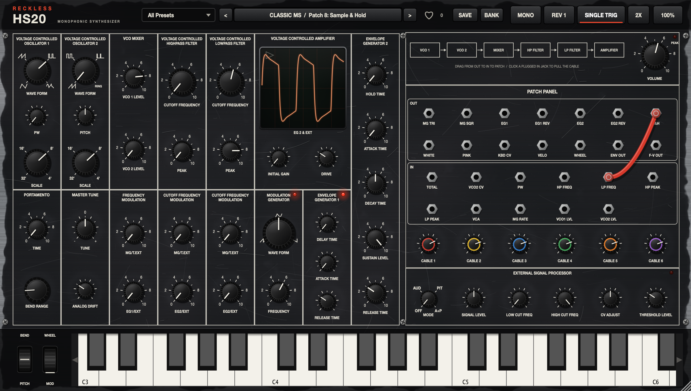

# Reckless HS20

**Synthé semi-modulaire analogique virtuel, inspiré du légendaire MS-20 de 1978.**
VST3 · AU · Standalone — macOS (Apple Silicon + Intel)



L'HS20 reprend l'architecture complète du MS-20 : deux VCO, deux filtres « 35 » qui crient,
deux enveloppes, un générateur de modulation, un panneau de patch avec de vrais câbles à brancher,
et l'External Signal Processor pour piloter le synthé avec ta voix ou une guitare.

## Fonctionnalités

| Section | Détails |
|---|---|
| **VCO 1** | Triangle, dent de scie, pulse à largeur variable (PW), bruit blanc · Scale 32'/16'/8'/4' |
| **VCO 2** | Dent de scie, carré, pulse étroit, **ring mod** · Pitch ±1 octave · Scale |
| **Filtres** | HPF puis LPF 2 pôles modélisés en *zero-delay feedback* avec saturation dans la boucle de résonance. **Self-oscillation** qui suit exactement la fréquence de coupure. Deux modèles : **Rev 1** (premiers MS-20, agressif) et **Rev 2** (OTA, plus doux) |
| **EG 1** | Delay / Attack / Release (comme l'original) |
| **EG 2** | Hold / Attack / Decay / Sustain / Release, courbes RC analogiques |
| **MG** | LFO à forme morphable (rampe descendante ↔ triangle ↔ rampe montante) + sortie carrée et Sample & Hold |
| **Patch panel** | 14 sorties, 11 entrées, 6 câbles. Glisser d'une sortie (OUT) vers une entrée (IN) pour patcher, cliquer sur une entrée branchée pour retirer / re-patcher le câble, clic droit pour tout débrancher. Chaque câble a son knob de niveau (bipolaire) |
| **ESP** | Entrée audio externe (sidechain) : préampli, passe-bande, suiveur d'enveloppe, gate à seuil, convertisseur fréquence → tension (pitch tracking) |
| **Caractère** | Dérive analogique des oscillateurs, dispersion entre voix, bruit de fond de circuit, drive d'entrée, suréchantillonnage 2x/4x |
| **Jeu** | **Mono fidèle** (priorité dernière note, single trigger, portamento) ou **Poly 8 voix** en bonus · pitch bend, mod wheel, sustain |
| **Interface** | Façade en métal brossé usé générée procéduralement, entièrement vectorielle : **redimensionnable de 50 % à 200 %** (poignée en bas à droite ou bouton `100%`), la taille est mémorisée |

## Presets & ❤️ Likes

**196 presets d'usine** classés en 12 catégories :

| Catégorie | Nb | | Catégorie | Nb |
|---|---|---|---|---|
| Basic | 4 | | Pad & Drone | 18 |
| Bass | 26 | | Sequence & S&H | 14 |
| Lead | 26 | | Percussion | 18 |
| Acid | 16 | | FX | 24 |
| Keys & Brass | 16 | | Ring & Metal | 12 |
| Classic MS | 16 | | ESP External | 6 |

Le volume de tous les presets est normalisé automatiquement, pour que la librairie se joue à niveau constant.

- **Liker un preset** : clique sur le ❤️ à côté du nom. Le compteur indique le nombre de presets likés.
- **Banque Liked** : choisis `♥ Liked` dans le sélecteur de banque. Les flèches `<` `>` ne parcourent alors que tes favoris. Le menu du nom affiche aussi un sous-menu `♥ Liked`.
- La banque est **tenue à jour automatiquement** dans
  `~/Library/Application Support/Reckless/HS20/Liked Bank.hs20bank` et partagée entre toutes les instances et tous tes DAW.
- `BANK ▸ Export Liked Bank…` exporte chaque preset liké (`.hs20preset`) et la banque complète dans le dossier de ton choix. `Import Bank…` la recharge, sur une autre machine par exemple.
- `SAVE` enregistre tes propres sons (`Save + Like` les ajoute directement aux favoris).

### 🎲 Presets aléatoires

Le **dé** à côté des flèches crée un son aléatoire à chaque clic. Ce n'est pas du hasard pur : chaque lancer choisit un type de son (Bass, Lead, Pad, Pluck, FX ou Sequence) et tire chaque réglage dans une plage qui sonne juste. Il peut aussi brancher des câbles de patch utiles.

- **Clic droit** sur le dé pour choisir le type de son à tirer (*Any* par défaut).
- Chaque son tiré reçoit un nom (ex. *Rusty Comet*) et son volume est **ajusté automatiquement** au niveau des presets d'usine.
- Un son te plaît ? Clique sur le ❤️ : il est **enregistré comme preset utilisateur et ajouté à la banque Liked** en un geste. Sinon, `SAVE` pour le nommer toi-même.

## Installation

Télécharge les zips depuis l'onglet **Releases**, puis :

- `Reckless HS20.vst3` → `~/Library/Audio/Plug-Ins/VST3/`
- `Reckless HS20.component` → `~/Library/Audio/Plug-Ins/Components/`

Les binaires ne sont pas notarisés par Apple. Si macOS les bloque :

```bash
xattr -dr com.apple.quarantine ~/Library/Audio/Plug-Ins/VST3/"Reckless HS20.vst3" ~/Library/Audio/Plug-Ins/Components/"Reckless HS20.component"
```

## Compiler soi-même

Prérequis : macOS 11+, Command Line Tools (ou Xcode), CMake ≥ 3.22.

```bash
git clone --recursive https://github.com/RecklessBoise/reckless-hs20.git
cd reckless-hs20
./build.sh install
```

Le script compile, lance les tests et installe les plug-ins.

### Structure

```
Source/dsp/          moteur audio : oscillateurs PolyBLEP, filtres MS-20, enveloppes, voix, ESP
Source/presets/      presets d'usine/utilisateur, likes et banque Liked
Source/ui/           look & feel, texture métal usé, patch panel, barre de presets
tools/               générateur de presets (Python) + outil de capture d'écran
tests/               tests : accord, filtres, 196 presets rendus, persistance des likes
```

Les presets sont décrits dans [`tools/generate_presets.py`](tools/generate_presets.py). Pour en ajouter :

```bash
python3 tools/generate_presets.py
./build/HS20Tests_artefacts/Release/HS20Tests --levels levels.json
python3 tools/generate_presets.py --levels levels.json
```

## Mentions

Reckless HS20 est un projet indépendant, **inspiré** du Korg MS-20. Il n'est ni affilié à, ni approuvé par Korg Inc.
« Korg » et « MS-20 » sont des marques de leurs propriétaires respectifs et ne sont cités ici qu'à titre de référence historique.

Construit avec [JUCE](https://juce.com) · Licence **GPLv3** (voir [LICENSE](LICENSE)).
